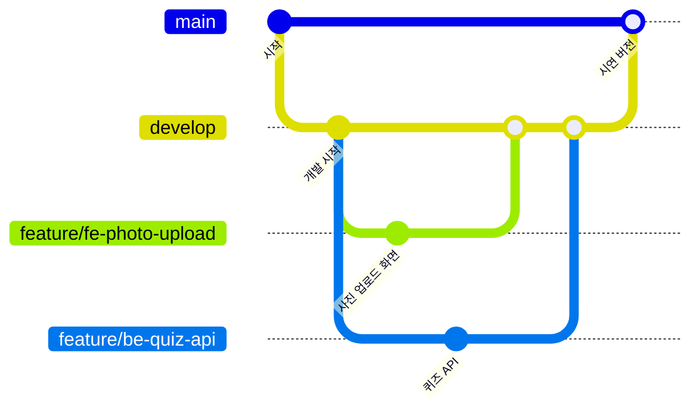
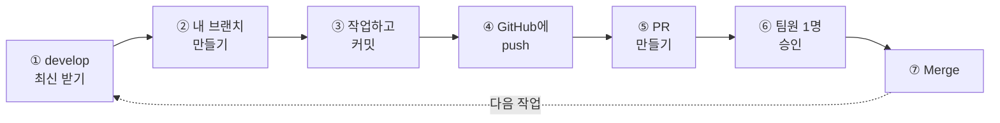

# only-app

팀 **ONLy:** · 스마트인재개발원 2026 기업연계 실전프로젝트 — 가족 참여형 AI 회상·사진 일기 앱

> 이 문서는 **Git을 처음 써 보는 사람도 그대로 따라 할 수 있게** 만든 팀 협업 가이드예요.
> 모르는 단어가 나오면 [1. 용어 정리](#1-용어-정리)를, 막히면 [12. 이럴 땐 이렇게](#12-이럴-땐-이렇게-faq)를 보세요.

## 꼭 지킬 3가지

> [!IMPORTANT]
> 1. **`main`, `develop`에는 직접 올리지 않아요.** 작업은 항상 **내 브랜치**에서 해요.
> 2. 작업이 끝나면 **PR**(합치기 요청)을 올리고, **팀원 1명이 승인**하면 합쳐요.
> 3. **`.env`, API 키, 비밀번호, 실제 사용자 사진·음성은 절대 올리지 않아요.** 이 저장소는 공개(public)라서 누구나 볼 수 있어요.

## 목차

1. [용어 정리](#1-용어-정리)
2. [브랜치 구조](#2-브랜치-구조)
3. [폴더 구조와 담당](#3-폴더-구조와-담당)
4. [처음 한 번만 하는 설정](#4-처음-한-번만-하는-설정)
5. [첫 연습: PR 한 번 해보기](#5-첫-연습-pr-한-번-해보기-10분)
6. [매일 작업하는 순서](#6-매일-작업하는-순서)
7. [PR 올리기와 리뷰하기](#7-pr-올리기와-리뷰하기)
8. [충돌(Conflict) 해결하기](#8-충돌conflict-해결하기)
9. [영역끼리 지킬 약속](#9-영역끼리-지킬-약속)
10. [이름 짓는 규칙](#10-이름-짓는-규칙)
11. [할 일 관리](#11-할-일-관리-issues-projects)
12. [이럴 땐 이렇게 (FAQ)](#12-이럴-땐-이렇게-faq)
13. [팀원](#13-팀원)

---

## 1. 용어 정리

| 용어 | 뜻 | 비유 |
|---|---|---|
| 저장소 (repository, 레포) | 프로젝트 파일이 전부 들어 있는 곳. 우리 팀은 `only-app` | 팀 공유 폴더 |
| clone (클론) | 저장소를 내 컴퓨터로 처음 내려받기. 딱 한 번만 해요 | 공유 폴더 통째로 다운로드 |
| branch (브랜치) | 다른 사람 작업에 영향 없이 따로 작업하는 공간 | 원본을 복사한 내 사본 |
| commit (커밋) | 바꾼 내용을 메모와 함께 저장하기 | 게임 세이브 |
| push (푸시) | 내 컴퓨터의 커밋을 GitHub에 올리기 | 업로드 |
| pull (풀) | GitHub의 최신 내용을 내 컴퓨터로 받기 | 다운로드 |
| PR (Pull Request) | "제 작업을 합쳐도 될까요?" 하고 올리는 요청 | 결재 올리기 |
| review / approve | 팀원이 PR을 보고 OK 해 주기 | 결재 승인 |
| merge (머지) | 내 브랜치 작업을 develop에 합치기 | 사본 내용을 원본에 반영 |
| conflict (충돌) | 두 사람이 같은 파일의 같은 줄을 다르게 고쳐서 Git이 뭘 남길지 모르는 상태 | 같은 문장을 둘이 동시에 고침 |

## 2. 브랜치 구조

브랜치는 3층이에요. 위로 갈수록 중요한 곳이라 직접 올리지 않아요.

| 브랜치 | 용도 | 직접 push |
|---|---|---|
| `main` | 발표·시연용. 항상 잘 돌아가는 버전 | ❌ 팀장이 develop에서 PR로 합쳐요 |
| `develop` | 모든 팀원의 작업이 모이는 곳 | ❌ PR로만 합쳐요 |
| `feature/...`, `fix/...` | 각자 작업하는 곳. 작업 하나에 브랜치 하나 | ✅ 내 브랜치만 |



- 각자 `develop`에서 브랜치를 만들어 작업하고, PR로 `develop`에 합쳐요.
- `develop` → `main`은 기업 멘토링 시연, 기획발표, 최종 제출(12/14) 전에 팀장이 동작을 확인하고 PR로 합쳐요. 그래서 `main`은 언제나 "보여 줘도 되는 버전"이에요.

## 3. 폴더 구조와 담당

| 폴더 | 들어가는 것 | 담당 | 브랜치 이름 예시 |
|---|---|---|---|
| `frontend/` | 화면 (웹앱) | 프론트엔드 | `feature/fe-photo-upload` |
| `backend/` | 서버, API, AI 에이전트 | 백엔드 | `feature/be-quiz-api` |
| `db/` | 테이블을 만드는 SQL(`schema.sql`), 더미 데이터 | DB | `feature/db-diary-table` |
| 최상위 파일 (`README.md`, `.gitignore` 등) | 팀 공용 설정과 문서 | 모두 (고치기 전에 단톡방에 한 마디) | `docs/readme-run-guide` |

폴더는 각 담당이 첫 PR을 올릴 때 만들어요.

> [!TIP]
> **내 담당 폴더만 고쳐요.** 다른 폴더를 고쳐야 하면 그 담당자에게 먼저 말하고, PR에 이유를 적어요. 이것만 지켜도 충돌이 거의 안 나요.

> [!WARNING]
> 실제 사용자 데이터와 외부 데이터셋(AI Hub 등)은 Git이 아니라 **팀 Google Drive**에 보관해요.
> `uploads/`, `recordings/`, `data/raw/`, `data/private/`, `aihub/` 폴더와 `.env` 파일은 `.gitignore`에 등록돼 있어서 자동으로 빠져요.

## 4. 처음 한 번만 하는 설정

준비물: GitHub 계정, Git, VS Code

### ① 초대 수락

GitHub 가입 이메일로 온 `only-smhrd-2026` 초대 메일에서 **Join**을 눌러요.
메일이 안 보이면 <https://github.com/orgs/only-smhrd-2026/invitation> 에 들어가요.

### ② 터미널 열기

VS Code 위쪽 메뉴 **터미널 → 새 터미널** (영어 화면이면 Terminal → New Terminal). 아래쪽에 명령어 입력창이 생겨요.
이 문서의 명령어는 전부 여기에 **한 줄씩** 입력해요. `#`으로 시작하는 줄은 설명이라 입력하지 않아도 돼요.

### ③ Git 설치 확인

```bash
git --version
```

`git version 2.xx.x`처럼 나오면 OK. 에러가 나면 <https://git-scm.com> 에서 설치하고(Windows는 전부 기본값으로 Next) VS Code를 껐다 켜요.
Mac은 설치 창이 뜨면 **설치**를 누르면 돼요.

### ④ 내 정보 등록

따옴표 안을 내 정보로 바꿔서 한 줄씩 입력해요.

```bash
git config --global user.name "내 이름 또는 GitHub 아이디"
git config --global user.email "GitHub에 가입한 이메일"
git config --global pull.rebase false
```

- 이메일은 **GitHub 가입 이메일과 똑같이** 써야 내 GitHub 프로필에 기여 기록(잔디)이 쌓여요. 포트폴리오에 중요해요.
- 마지막 줄은 나중에 pull 할 때 에러가 안 나게 해 주는 설정이에요.

### ⑤ 저장소 내려받기 (clone)

**방법 A (추천)**: VS Code 시작 화면에서 **Git 리포지토리 복제**(Clone Git Repository)를 눌러요.
아래 주소를 붙여 넣고 → 저장할 폴더를 고르고 → **열기**를 눌러요.
시작 화면이 없으면 왼쪽 **소스 제어** 아이콘에서 **리포지토리 복제**를 눌러도 돼요.

```text
https://github.com/only-smhrd-2026/only-app.git
```

**방법 B**: 터미널에서 직접 받아요. 받은 다음 VS Code에서 **파일 → 폴더 열기 → `only-app`** 으로 열어요.

```bash
git clone https://github.com/only-smhrd-2026/only-app.git
```

### ⑥ develop 브랜치로 이동

`only-app` 폴더를 연 VS Code에서 터미널을 열고 입력해요.

```bash
git checkout develop
```

`Switched to branch 'develop'` 또는 `Already on 'develop'`이 나오면 준비 끝!

> [!NOTE]
> - 처음 push 할 때 GitHub 로그인 창이 떠요. 브라우저에서 로그인하고 **Authorize**를 누르면 돼요.
> - 터미널이 어렵다면 [GitHub Desktop](https://desktop.github.com)을 써도 돼요. 버튼만 다를 뿐 규칙(내 브랜치에서 작업 → PR → 승인 → Merge)은 똑같아요.

## 5. 첫 연습: PR 한 번 해보기 (10분)

실제 코드를 만지기 전에, 아무 문제 없는 연습 파일로 전체 과정을 한 번 해 봐요. **모두 한 번씩** 해요.
`내아이디` 부분은 본인 GitHub 아이디로 바꿔요. (예: `practice/hongjinkong`)

```bash
git checkout develop
git pull origin develop
git checkout -b practice/내아이디
```

VS Code에서 `practice` 폴더를 만들고, 그 안에 `내아이디.md` 파일을 만들어 한 줄 적고 저장해요.
(예: `안녕하세요, 백엔드 담당 OOO입니다!`)

```bash
git add practice/
git commit -m "docs: OOO 연습 파일 추가"
git push -u origin practice/내아이디
```

그다음 [7. PR 올리기와 리뷰하기](#7-pr-올리기와-리뷰하기)를 보면서 PR을 만들고, **옆 사람끼리 서로 승인**해 준 뒤 Merge까지 해 보면 끝이에요.
연습 파일은 나중에 팀장이 정리해요.

## 6. 매일 작업하는 순서



### ①~④ 내 컴퓨터에서

```bash
# ① develop 최신 내용 받기
git checkout develop
git pull origin develop

# ② 작업용 브랜치 만들기 (작업 하나에 브랜치 하나)
git checkout -b feature/be-quiz-api

# ③ 코드 작업 → 바뀐 파일 확인 → 내 폴더만 담아서 커밋
git status
git add backend/
git commit -m "feat(be): 퀴즈 조회 API 추가"

# ④ GitHub에 올리기 (처음 push 할 때만 -u origin 브랜치이름)
git push -u origin feature/be-quiz-api
```

### ⑤~⑦ GitHub 웹에서

[7. PR 올리기와 리뷰하기](#7-pr-올리기와-리뷰하기)를 따라 해요.

### Merge가 끝나면 정리

```bash
git checkout develop
git pull origin develop
git branch -d feature/be-quiz-api
```

그리고 다음 작업은 다시 ①부터 시작해요.

> [!TIP]
> - `git add .` 대신 `git add backend/`처럼 **내 폴더만** 담아요. 남의 파일이나 `.env`가 실수로 같이 올라가는 걸 막아 줘요.
> - 커밋은 기능 조각마다 자주, push는 적어도 하루에 한 번 해요. 컴퓨터가 고장 나도 GitHub에 남아 있어요.
> - PR이 Merge되기 전까지는 같은 브랜치에서 계속 커밋하고 push 하면 PR에 자동으로 추가돼요. Merge된 뒤에는 새 브랜치를 만들어요.

### 작업이 이틀 넘게 걸리면

중간에 develop 최신 내용을 내 브랜치에 합쳐 둬요. 늦게 합칠수록 충돌이 커져요.

```bash
# 먼저 내 작업을 커밋하고
git add backend/
git commit -m "feat(be): 퀴즈 채점 중간 저장"

# develop 최신 내용을 내 브랜치에 합치기 (--no-edit: 메시지 입력창이 안 뜨게)
git pull --no-edit origin develop
git push
```

### 명령어 한눈에 보기

| 하고 싶은 것 | 명령어 |
|---|---|
| 지금 어느 브랜치인지, 뭐가 바뀌었는지 보기 | `git status` |
| develop으로 이동 | `git checkout develop` |
| GitHub 최신 내용 받기 | `git pull origin develop` |
| 새 브랜치 만들고 이동 | `git checkout -b feature/be-quiz-api` |
| 내 폴더 변경 담기 | `git add backend/` |
| 커밋 | `git commit -m "feat(be): 퀴즈 조회 API 추가"` |
| 처음 올리기 | `git push -u origin feature/be-quiz-api` |
| 두 번째부터 올리기 | `git push` |
| 다 쓴 브랜치 지우기 | `git branch -d feature/be-quiz-api` |

## 7. PR 올리기와 리뷰하기

### PR 올리는 사람

1. push 하고 저장소 페이지에 들어가면 노란 띠에 **Compare & pull request** 버튼이 보여요. 눌러요.
   (안 보이면 **Pull requests** 탭 → **New pull request**)
2. 위쪽이 `base: develop` ← `compare: 내 브랜치`인지 확인해요. **base가 main이면 develop으로 바꿔요.**
3. 제목은 커밋 메시지처럼 써요. 예: `feat(be): 퀴즈 조회 API 추가`
4. 본문은 자동으로 나오는 템플릿 칸을 채워요. 관련 이슈가 있으면 `Closes #12`처럼 적어요.
5. 오른쪽 **Reviewers** 옆 톱니바퀴를 눌러 리뷰어 1명을 지정해요. (같은 영역 사람, 없으면 아무나)
6. **Create pull request**를 눌러요.
7. 승인(Approved)을 받으면 **Merge pull request** → **Confirm merge**. 이어서 **Delete branch** 버튼이 보이면 눌러요.

### 리뷰하는 사람

1. PR에서 **Files changed** 탭을 눌러 바뀐 내용을 봐요.
2. 이 3가지만 확인해도 충분해요.
   - 담당 폴더 밖을 고치지 않았나? (고쳤다면 이유가 적혀 있나?)
   - `.env`, API 키, 비밀번호, 실제 사진이나 개인정보가 들어 있지 않나?
   - PR 설명만 보고 무엇을 했는지 알 수 있나?
3. 괜찮으면 **Review changes**(또는 **Submit review**) → **Approve** → **Submit review**를 눌러요.
   고칠 게 있으면 **Request changes**를 고르고 코멘트를 남겨요.
4. 수정 요청을 받은 사람은 같은 브랜치에서 고쳐서 다시 push 하면 돼요. PR에 자동으로 반영돼요.

> [!NOTE]
> 내가 올린 PR은 내가 승인할 수 없어요. 리뷰 요청을 받으면 **반나절 안에** 봐 주세요. 다들 서로 기다리고 있어요.

## 8. 충돌(Conflict) 해결하기

충돌은 실수가 아니에요. 두 사람이 같은 줄을 고쳤을 때 Git이 "어느 쪽으로 할까요?" 하고 물어보는 거예요.

**이럴 때 생겨요**: pull 했더니 `CONFLICT (content): Merge conflict in ...`이 나오거나, PR 화면에 `This branch has conflicts that must be resolved`가 보일 때

### 해결 순서

1. 내 브랜치에서 develop 최신 내용을 받아요.

   ```bash
   git pull --no-edit origin develop
   ```

2. VS Code 왼쪽 **소스 제어** 아이콘을 누르고, **병합 변경 내용**(Merge Changes) 아래에 있는 파일을 열어요.
3. 충돌 부분 위에 뜨는 버튼 중 하나를 눌러요.

   | 버튼 | 뜻 |
   |---|---|
   | Accept Current Change (현재 변경 사항 수락) | **내 것**을 남겨요 |
   | Accept Incoming Change (수신 변경 사항 수락) | **develop에서 온 것**을 남겨요 |
   | Accept Both Changes (두 변경 사항 모두 수락) | **둘 다** 남겨요 |

4. 파일에 `<<<<<<<`, `=======`, `>>>>>>>` 표시가 하나도 안 남았는지 확인하고 저장해요.
5. 마무리해요. (`git add` 대신 소스 제어에서 파일 옆 **+** 버튼을 눌러도 돼요)

   ```bash
   git add 충돌난파일경로
   git commit -m "chore: develop 최신 내용 합치기"
   git push
   ```

> [!TIP]
> - **남의 코드와 충돌**했으면 혼자 고르지 말고 그 담당자를 불러서 같이 봐요.
> - 너무 꼬였으면 `git merge --abort`를 입력해요. pull 하기 전 상태로 돌아가요.

## 9. 영역끼리 지킬 약속

### 프론트엔드 ↔ 백엔드: API 모양부터 정하기

- 백엔드는 기능을 다 만들기 전에 **빈 API부터** 올려요. 주소·요청·응답 형식만 정하고 가짜 데이터를 돌려주는 API예요.
  FastAPI는 이것만 올려도 `http://localhost:8000/docs`에 API 문서(Swagger)가 자동으로 생겨요.
- 프론트엔드는 그 문서를 보고 바로 화면을 연결해요. 백엔드가 진짜 기능을 채우는 동안 기다리지 않아도 돼요.
- 응답 형식(필드 이름이나 구조)을 바꾸는 PR은 **프론트엔드 담당을 리뷰어로** 지정해요. 말없이 바꾸면 화면이 깨져요.
- 프론트 개발 서버(예: Vite `5173`)에서 백엔드(`8000`)를 부르면 **CORS 에러**가 나요. 백엔드에 처음부터 허용 설정을 넣어 둬요.

```python
# 백엔드 메인 파일 (예: main.py)
from fastapi.middleware.cors import CORSMiddleware

app.add_middleware(
    CORSMiddleware,
    allow_origins=["http://localhost:5173"],  # 프론트 개발 서버 주소. "*"(전부 허용)는 쓰지 않아요
    allow_methods=["*"],
    allow_headers=["*"],
)
# 배포할 때는 allow_origins에 실제 도메인을 추가해요
```

### 백엔드 ↔ DB: `db/schema.sql` 하나로 관리

- 테이블 구조 변경은 **DB 담당이 `db/schema.sql`을 고치는 PR로만** 해요. 다른 사람은 DB를 직접 바꾸지 말고 이슈나 단톡방으로 요청해요.
- 스키마를 바꾸면 **테이블명세서(산출물)도 같이** 고쳐요. 문서와 코드가 다르면 발표 때 바로 질문받아요.
- 개발할 때는 각자 **내 컴퓨터 MySQL**에 `db/schema.sql` → 더미 데이터 SQL 순서로 실행해서, 모두 같은 DB 상태로 맞춰요.
- 공용 DB 서버는 통합 테스트와 시연용으로만 써요. 개발까지 같이 쓰면 누가 테스트하다 데이터를 지울 때 다 같이 멈춰요.
- 더미 데이터에는 실제 사람 이름, 전화번호, 사진을 쓰지 않아요.

### 비밀 정보: `.env`

- API 키, DB 비밀번호는 코드에 직접 쓰지 않고 `.env` 파일에만 적어요. `.env`는 `.gitignore`에 등록돼 있어서 GitHub에 안 올라가요.
- 필요한 키 목록은 `.env.example`(키 이름만 있고 값은 빈 파일)로 공유하고, 실제 값은 GitHub 밖에서(개인 메시지 등) 전달해요. 이슈, PR, 코드 어디에도 적지 않아요.
- 코드에서는 `os.getenv("LLM_API_KEY")`처럼 읽어요.

### 공용 파일

- `README.md`, `.gitignore`, `requirements.txt`처럼 여럿이 고치는 파일은 충돌이 잘 나요.
- 필요한 줄만 **추가**하고, 기존 줄의 순서를 바꾸거나 정렬하지 않아요. 크게 고칠 때는 단톡방에 먼저 말해요.

## 10. 이름 짓는 규칙

### 브랜치: `종류/영역-작업내용`

영어 소문자로 쓰고, 단어 사이는 `-`로 이어요. 한글과 띄어쓰기는 쓰지 않아요.

| 종류 | 언제 | 예시 |
|---|---|---|
| `feature/` | 새 기능 | `feature/fe-photo-upload`, `feature/be-quiz-api`, `feature/db-diary-table` |
| `fix/` | 버그 수정 | `fix/fe-login-button` |
| `docs/` | 문서만 수정 | `docs/readme-run-guide` |

영역: `fe` 프론트엔드, `be` 백엔드, `db` DB

### 커밋 메시지: `종류(영역): 무엇을 했는지`

한글로 써도 돼요.

| 종류 | 뜻 | 예시 |
|---|---|---|
| `feat` | 기능 추가 | `feat(fe): 사진 업로드 화면 추가` |
| `fix` | 버그 수정 | `fix(be): 퀴즈 날짜 계산 오류 수정` |
| `docs` | 문서 | `docs: README 실행 방법 추가` |
| `refactor` | 동작은 그대로 두고 코드 정리 | `refactor(be): 퀴즈 생성 함수 분리` |
| `chore` | 설정, 기타 | `chore: .gitignore에 로그 폴더 추가` |

`수정`, `ㅇㅇ`, `final`, `진짜최종` 같은 메시지는 일주일만 지나도 아무도 못 알아봐요.

## 11. 할 일 관리 (Issues, Projects)

- 할 일은 **Issue**로 만들어요. **Issues** 탭 → **New issue** → 제목(예: `퀴즈 조회 API`) → 오른쪽 **Assignees**에 담당자, **Labels**에 `FE`/`BE`/`DB`를 지정해요.
- 진행 상황은 **Projects 보드**에서 `Todo` → `In Progress` → `Done`으로 옮기면서 봐요. PM의 WBS와 맞춰요.
- PR 본문에 `Closes #12`를 쓰면 Merge될 때 12번 이슈가 자동으로 닫혀요.

## 12. 이럴 땐 이렇게 (FAQ)

<details>
<summary><b>develop에서 바로 작업해 버렸어요</b></summary>

**아직 커밋 전이라면** 브랜치만 새로 만들면 돼요. 바꾼 내용이 그대로 따라와요.

```bash
git checkout -b feature/be-quiz-api
```

**이미 커밋했다면** 똑같이 브랜치를 만들어 push 하고 PR을 올려요.

```bash
git checkout -b feature/be-quiz-api
git push -u origin feature/be-quiz-api
```

그다음 내 컴퓨터의 develop을 GitHub 상태로 되돌려요. ⚠️ 위 push가 성공한 걸 확인한 뒤에만 하세요.

```bash
git checkout develop
git fetch origin
git reset --hard origin/develop
```

</details>

<details>
<summary><b>push 했더니 rejected / protected branch 에러가 나요</b></summary>

`main`이나 `develop`에 직접 push 하려고 해서 막힌 거예요. 위 항목처럼 내 브랜치를 만들어서 push 해요.

내 브랜치인데도 rejected가 나오면(다른 컴퓨터나 GitHub 웹에서 고친 경우) 먼저 받고 다시 올려요.

```bash
git pull --no-edit
git push
```

</details>

<details>
<summary><b>.env나 API 키를 실수로 올렸어요</b></summary>

1. **바로 팀에 알리고, 그 키를 발급한 사이트에서 키를 삭제하고 새로 발급해요.** 이게 제일 중요해요.
2. 공개 저장소는 자동 수집 봇이 몇 분 안에 키를 가져갈 수 있어요. 파일만 지우면 커밋 기록에 그대로 남아 있어서 소용없어요.
3. 그다음 파일을 지우는 커밋을 올리고, `.gitignore`에 들어 있는지 확인해요.

</details>

<details>
<summary><b>pull 할 때 'Your local changes would be overwritten' 에러가 나요</b></summary>

커밋 안 한 변경이 있어서 그래요. 먼저 커밋하고 다시 pull 해요.

```bash
git add backend/
git commit -m "feat(be): 작업 중간 저장"
git pull --no-edit origin develop
```

</details>

<details>
<summary><b>'Need to specify how to reconcile divergent branches' 에러가 나요</b></summary>

[처음 설정](#4-처음-한-번만-하는-설정)의 `git config --global pull.rebase false`를 안 해서 그래요. 한 번 입력하고 다시 pull 해요.

</details>

<details>
<summary><b>검은 화면에 이상한 글자가 떴어요 (Vim)</b></summary>

커밋 메시지를 입력하라는 편집기예요. **Esc** → `:wq` 입력 → **Enter** 하면 저장하고 빠져나와요.
이 문서의 명령어처럼 `-m`이나 `--no-edit`를 붙이면 안 떠요.

</details>

<details>
<summary><b>push 할 때 비밀번호를 물어보는데 GitHub 비밀번호가 안 돼요</b></summary>

GitHub는 터미널에서 비밀번호 로그인을 막아 놨어요.

- VS Code 터미널에서 push 하면 **브라우저 로그인 창**이 떠요. 거기서 로그인하면 돼요. (Windows는 Git을 설치할 때 같이 깔린 로그인 창이 떠요)
- 그래도 안 되면 [GitHub CLI](https://cli.github.com)를 설치하고 `gh auth login`을 실행해서 안내대로 로그인해요.

</details>

<details>
<summary><b>PR에 내가 안 고친 파일이 잔뜩 보여요</b></summary>

PR의 base가 `main`으로 되어 있을 가능성이 커요. PR 제목 옆 **Edit**를 누르고 base를 `develop`으로 바꿔요.

`git add .`로 다른 파일까지 담았다면 리뷰어와 같이 정리하고, 다음부터는 `git add 내폴더/`로 담아요.

</details>

<details>
<summary><b>다른 팀원 브랜치를 내 컴퓨터에서 실행해 보고 싶어요</b></summary>

```bash
git fetch origin
git checkout feature/fe-photo-upload
```

다 보고 나면 `git checkout develop`으로 돌아와요. 남의 브랜치에는 커밋하지 않아요.

</details>

<details>
<summary><b>git branch -d 했더니 'not fully merged'라고 나와요</b></summary>

먼저 `git checkout develop` → `git pull origin develop`을 했는지 확인해요.
그래도 나오면 PR이 Merge된 게 확실할 때만 `git branch -D 브랜치이름`으로 지워요.

</details>

## 13. 팀원

역할이 정해지면 팀장이 한 번에 채워요. (여럿이 동시에 고치면 충돌이 나요)

| 이름 | 역할 | 담당 폴더 | GitHub |
|---|---|---|---|
| [이름] | [역할] | [폴더] | [@아이디] |
| [이름] | [역할] | [폴더] | [@아이디] |
| [이름] | [역할] | [폴더] | [@아이디] |
| [이름] | [역할] | [폴더] | [@아이디] |
| [이름] | [역할] | [폴더] | [@아이디] |

<details>
<summary><b>팀장·Owner만 보세요: 저장소 설정 체크리스트</b></summary>

- [ ] **팀원 권한**: org **Settings → Member privileges → Base permissions**를 **Write**로
- [ ] **Owner 2명 이상**: org **People**에서 팀장 외 1명을 Owner로
- [ ] **develop 브랜치 만들기**: 저장소 브랜치 버튼(`main`) → **View all branches** → **New branch** → 이름 `develop`, Source `main`
- [ ] **기본 브랜치를 develop으로**: 저장소 **Settings → General → Default branch** → 화살표 버튼 → `develop` → **Update**
      (PR이 자동으로 develop을 향하고, `Closes #12`도 develop에 Merge될 때 작동해요)
- [ ] **보호 규칙**: 저장소 **Settings → Rules → Rulesets → New ruleset → New branch ruleset**
  - Enforcement status: **Active**
  - Target branches: **Add target → Include by pattern** → `main`, `develop` 각각 추가
  - Rules: **Restrict deletions**, **Require a pull request before merging**(Required approvals `1`), **Block force pushes** 체크 → **Create**
- [ ] **Merge 후 브랜치 자동 삭제**: **Settings → General → Pull Requests → Automatically delete head branches** 체크
- [ ] **라벨**: **Issues → Labels → New label** → `FE`, `BE`, `DB`
- [ ] **Projects 보드**: org **Projects → New project → Board** → 저장소 `only-app` 연결
- [ ] **2단계 인증(2FA) 필수**: 팀원 모두 2FA를 켠 **다음에** org **Settings → Authentication security → Require two-factor authentication**
      (2FA를 안 켠 사람은 org에서 자동으로 빠지니까 순서를 지켜요)

</details>

---

이 문서도 고칠 점이 보이면 `docs/` 브랜치로 PR을 올려 주세요.
